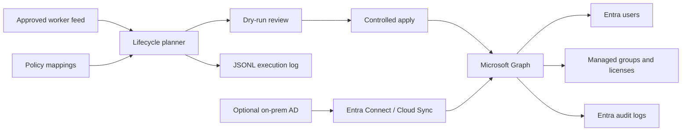

# Project 1 — Entra ID Identity Lifecycle Automation


> A portfolio IAM project demonstrating Microsoft Entra ID joiner–mover–leaver
> automation with Microsoft Graph, Python, PowerShell, and Azure Automation.


> A portfolio/lab project that simulates identity and access management for a fictional healthcare organization, **TJ Health Care IAM Lab**.

[](docs/ARCHITECTURE.md)
[](python/)
[](https://www.microsoft.com/security/business/identity-access/microsoft-entra-id)

## Project overview

This project demonstrates a dry-run-first **joiner–mover–leaver** identity lifecycle process using Microsoft Entra ID, Microsoft Graph, Python, PowerShell, Azure Automation, and optional on-premises Active Directory mappings.

It is designed to show how an IAM engineer can automate approved identity changes while preserving least-privilege boundaries, operational review, and audit evidence.

> **Scope notice:** This is a fictional healthcare-sector lab using synthetic identities. It is not a production system, is not HIPAA-certified, and does not process patient records or protected health information.

## Why I built this project

I am building this project as part of my goal to become an IAM engineer while
studying for the Microsoft SC-300 certification.

I wanted practical experience with Microsoft Entra ID, Microsoft Graph,
PowerShell, Python, authentication, identity lifecycle management,
offboarding, and audit logging.


## Business problem

Manual onboarding, role changes, and offboarding can lead to delayed access, excessive group membership, unused licenses, and weak evidence of what changed. This project models a controlled lifecycle process that:

- Uses an approved worker feed as the input contract
- Calculates changes before applying them
- Maps worker attributes to managed groups
- Uses group-based licensing by default
- Removes access when a worker is terminated
- Produces structured execution evidence
- Separates cloud-managed and AD-managed identities

## What I built

| Capability | Implementation |
| --- | --- |
| Lifecycle planning | Python planner with deterministic dry-run output |
| Graph connectivity | Read-only `/organization` check through Azure Identity |
| User management | Microsoft Graph v1.0 and Microsoft Graph PowerShell |
| Group reconciliation | Allowlisted managed group membership changes |
| Microsoft 365 licensing | Group-based licensing by default; direct SKU removal is explicit |
| Offboarding | Disable account, revoke sessions, remove managed access |
| Hybrid identity | Optional on-premises AD PowerShell path |
| Unattended execution | Azure Automation PowerShell 7.4 runbook with managed identity |
| Audit evidence | JSONL execution events plus tenant-side Entra audit logs |
| Safety controls | Dry-run default, action limits, placeholder rejection, no deletion |
| Testing | Offline Python unit tests and GitHub Actions CI |

## Architecture



See [docs/ARCHITECTURE.md](docs/ARCHITECTURE.md) for the detailed design and [docs/OPERATIONS.md](docs/OPERATIONS.md) for the operator workflow.

## Project status

| Stage | Status | Evidence |
| --- | --- | --- |
| Local Python environment | Complete | VS Code virtual environment |
| Offline unit tests | Complete | 7 tests passing |
| Azure CLI tenant authentication | Complete | Tenant-level login without subscription |
| Read-only Graph connectivity | Complete | `/organization` check; `writes_performed=false` |
| Real-tenant lifecycle dry-run | Next | One non-admin lab user and one lab group |
| Controlled apply pilot | Planned | Non-production tenant and reviewed permissions |
| Azure Automation deployment | Planned | Requires an Azure subscription |

## Quick start: offline testing

### Prerequisites

- Python 3.11 or newer
- VS Code or another Python-capable editor
- PowerShell on Windows, or Bash on macOS/Linux

### Set up the environment

Windows PowerShell:

```powershell
python -m venv .venv
.\.venv\Scripts\Activate.ps1
python -m pip install -r python\requirements.txt
```

macOS/Linux:

```bash
python3 -m venv .venv
source .venv/bin/activate
python -m pip install -r python/requirements.txt
```

### Run the tests

```bash
python -m unittest discover -s tests -v
```

Expected result:

```text
Ran 7 tests
OK
```

### Run the sample dry-run

Windows PowerShell:

```powershell
python python\identity_lifecycle.py `
  --input data\sample-workers.csv `
  --config config\policy.json `
  --dry-run
```

macOS/Linux:

```bash
python3 python/identity_lifecycle.py \
  --input data/sample-workers.csv \
  --config config/policy.json \
  --dry-run
```

The sample policy contains placeholders and intentionally cannot modify a real tenant.

## Stage 1: read-only Microsoft Graph connectivity

After the offline tests pass, authenticate to the intended Entra tenant. An Azure subscription is not required for this read-only check:

```powershell
az login --tenant YOUR_TENANT_ID --allow-no-subscriptions
python python\check_graph_connection.py --tenant-id YOUR_TENANT_ID
```

The checker acquires a Graph token through `DefaultAzureCredential` and performs only:

```http
GET /organization?$select=id,displayName,verifiedDomains
```

It verifies the returned organization ID and reports:

```json
{
  "writes_performed": false
}
```

It does not create users, modify groups, assign licenses, disable accounts, revoke sessions, or delete data.

See [docs/STAGE-1-GRAPH-CONNECTIVITY.md](docs/STAGE-1-GRAPH-CONNECTIVITY.md) for the evidence record and screenshot checklist.

## Stage 2: controlled lab dry-run

The next milestone is to create one dedicated non-admin lab user and one security group, then run a real-tenant dry-run. Do not begin with `--apply`.

1. Create a non-admin test user.
2. Create an assigned security group such as `P1-Lab-Engineering`.
3. Copy the group object ID into a private local policy file.
4. Create a private worker feed containing only the lab user.
5. Run the planner in `--dry-run` mode.
6. Review the actions and JSONL output.

Use the project’s safety controls and never test against administrator or emergency-access accounts.

## Apply boundary

Apply mode is intentionally a later milestone. Before using it, complete a tenant-specific review of:

- Microsoft Graph permissions and admin consent
- Directory roles for delegated execution
- Group and SKU object IDs
- Source of authority for each identity
- Break-glass and privileged-account exclusions
- Feed freshness and approval controls
- Rollback and incident procedures

The sample policy is placeholder-based and apply mode fails closed until the tenant-specific values are replaced.

## Repository guide

| Path | Purpose |
| --- | --- |
| `python/identity_lifecycle.py` | Python lifecycle planner and Graph client |
| `python/check_graph_connection.py` | Read-only token and Graph connectivity check |
| `powershell/Invoke-IdentityLifecycle.ps1` | Operator/CI Microsoft Graph PowerShell implementation |
| `powershell/Invoke-OnPremAdJoiner.ps1` | Optional on-premises AD joiner/mover/leaver path |
| `powershell/Export-EntraDirectoryAudits.ps1` | Tenant-side Entra audit export |
| `azure-automation/Invoke-IdentityLifecycle.runbook.ps1` | Managed-identity Azure Automation runbook |
| `config/policy.json` | Tenant-neutral policy template |
| `data/sample-workers.csv` | Synthetic worker feed |
| `tests/` | Offline unit tests |
| `docs/ARCHITECTURE.md` | System design and technical decisions |
| `docs/PERMISSIONS-MATRIX.md` | Graph permissions and security review starting point |
| `docs/OPERATIONS.md` | Preflight, execution, monitoring, and recovery runbook |
| `docs/TEST-PLAN.md` | Test strategy and acceptance criteria |
| `docs/DEMO-SCRIPT.md` | Interview and portfolio demonstration script |
| `docs/SC-300-MAPPING.md` | Mapping to SC-300 learning areas |
| `docs/STAGE-1-GRAPH-CONNECTIVITY.md` | Completed Stage 1 evidence record |
| `docs/GITHUB-PUBLISHING.md` | Safe GitHub repository setup and publishing workflow |
| `SECURITY.md` | Credential handling and security reporting boundaries |
| `CONTRIBUTING.md` | Safe contribution and documentation expectations |
| `screenshots/` | Redacted portfolio evidence only |

## Security controls

- Dry-run is the default.
- Apply mode requires an explicit flag.
- User deletion is disabled.
- Termination actions have a per-run limit.
- Unresolved tenant, group, and SKU placeholders block apply mode.
- Only allowlisted managed groups are reconciled.
- Privileged role-assignable groups are excluded from this starter project.
- Managed identity or workload identity is preferred over client secrets.
- Passwords, access tokens, and secrets are excluded from logs.
- Empty or invalid worker feeds fail closed.
- Real tenant files and screenshots must remain private or be redacted.

## Limitations and future work

This portfolio implementation does not yet provide:

- A live HRIS integration
- Conditional Access policy deployment
- PIM or privileged-role automation
- Access reviews or entitlement-management workflows
- A production approval portal
- Log Analytics dashboards
- A full mailbox, OneDrive, or retention process

Planned follow-up labs include Conditional Access in report-only mode, PIM, access reviews, workload identity security, and KQL monitoring.

## Portfolio and SC-300 relevance

This project demonstrates practical exposure to:

- Microsoft Entra user and group administration
- Joiner–mover–leaver lifecycle design
- Microsoft Graph and PowerShell automation
- Azure Identity and token acquisition
- Managed identities and workload identity concepts
- Hybrid identity source-of-authority decisions
- Group-based licensing
- Audit evidence and operational safety

See [docs/SC-300-MAPPING.md](docs/SC-300-MAPPING.md) for the boundaries of what this project demonstrates and what should be covered in separate labs.

## References

- [Microsoft Graph API](https://learn.microsoft.com/en-us/graph/overview)
- [Microsoft Graph permissions reference](https://learn.microsoft.com/en-us/graph/permissions-reference)
- [Azure Identity authentication guidance](https://learn.microsoft.com/en-us/azure/developer/python/sdk/authentication-overview)
- [Microsoft SC-300 study guide](https://learn.microsoft.com/en-us/credentials/certifications/resources/study-guides/sc-300)

## Author notes

This repository is maintained as a learning and portfolio project. Keep tenant-specific configuration, lab worker feeds containing real UPNs, audit exports, credentials, and unredacted screenshots outside the public repository.
