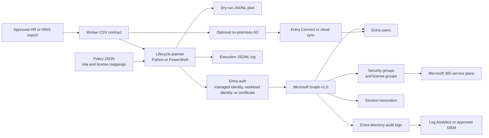

# Project 1 — Entra ID Identity Lifecycle Automation Architecture

## Executive design

Project 1 implements a controlled **joiner–mover–leaver** process. An approved worker feed is transformed into an action plan. The plan creates or updates cloud users when the source of authority is cloud, assigns access through managed security groups, provisions Microsoft 365 licenses through license-bearing groups, and removes access when a worker is terminated. The termination workflow disables the account, revokes sign-in sessions, removes memberships from groups managed by this project, and removes direct licenses when direct assignment was explicitly enabled.

The automation is intentionally **dry-run-first**. The default execution produces a plan and a local JSON Lines log. Tenant writes occur only when an operator or scheduled runbook supplies an explicit apply switch. This design reduces the likelihood that a malformed HR export or an incorrect group mapping creates a broad tenant change.

Microsoft Entra ID records directory changes in its tenant audit logs. The package also records its own correlation-oriented execution log. The two logs serve different purposes: Entra audit logs are the authoritative tenant-side record of directory operations, while the local JSON Lines log records input worker identifiers, planned actions, run identifiers, and automation outcomes. Entra audit logs include changes to users, groups, applications, and licenses, and the entries cannot be changed or deleted through the normal user interface.[7]

## Scope and non-goals

The package provisions and deprovisions **member users**. It does not manage privileged role assignments, application permissions, mailbox retention, SharePoint ownership, Teams ownership, device wipe, Conditional Access policy changes, or legal holds. These controls require separate approval workflows because they have a larger blast radius or depend on workload-specific retention rules.

The package does not delete users. A terminated user is preserved in a disabled state so that mailbox, OneDrive, audit, litigation-hold, and retention decisions remain under the organization’s existing Microsoft 365 process. The policy contains `delete_user: false` as an explicit safety invariant.

## Reference architecture

The **source of authority** must be declared in policy. If `source_of_authority` is `cloud`, the Python, operator PowerShell, or Azure Automation path may create a cloud user. If it is `on_premises_ad` or `hybrid`, the on-premises AD script creates or updates the AD object and synchronization creates or updates the Entra object. The cloud script refuses to create a duplicate user in the latter modes.

## Execution options

The implementation is packaged for three practical execution models. The first is the recommended production model when the organization already operates Azure. The second is a lighter-weight model for pilots and controlled change windows. The third is the hybrid model for organizations whose HR and account authority remains on-premises.

| Approach | Tradeoffs | Cost | Setup Complexity |
| --- | --- | --- | --- |
| Azure Automation PowerShell runbook with managed identity | Runs on a schedule without a workstation; secrets are avoided; job output can stream to Log Analytics. Requires Azure Automation, managed identity permissions, modules, variables, and a deployment process. | Azure service and Log Analytics charges according to the organization’s subscription and usage. | Medium |
| Local or CI Python/PowerShell execution | Fastest pilot path; easy to review pull requests and run dry-runs. Requires a secure runner, credential lifecycle, network access, and an external scheduler for recurring execution. | Low infrastructure cost; operational cost is carried by the runner and maintenance. | Low to medium |
| Hybrid on-premises AD joiner plus Entra reconciliation | Preserves on-premises AD as source of authority and supports directory synchronization. Requires domain connectivity, AD delegated rights, and correct sync scope. | Existing AD and sync infrastructure; no additional application runtime required beyond the operator or scheduler. | Medium to high |

For a production tenant, use Azure Automation with a **user-assigned or system-assigned managed identity** and no client secret. Microsoft’s documented pattern is to authenticate a runbook with `Connect-MgGraph -Identity`; a user-assigned identity can be selected with `-ClientId`.[8] Azure Automation’s managed-identity runbook guidance recommends a PowerShell 7.4 runtime environment and assigning permissions to the identity before execution.[9]

## Lifecycle behavior

### Joiner

For an active or pre-hire record, the planner produces `ensure_user` and `reconcile_managed_groups`. Existing users are updated with display name, given name, surname, department, job title, employee ID, usage location, and an enabled account state. A new cloud user is created with the required Graph properties: account state, display name, mail nickname, user principal name, and password profile. Microsoft Graph documents these properties as required or relevant for user creation.[1]

The initial password is never placed in the CSV or policy. The Python path reads it from an environment variable only when it must create a new cloud user. The Azure Automation runbook reads it from an Automation credential asset. The user is required to change it at first sign-in. A production organization may replace this password-based creation step with a passwordless or invitation-based onboarding design.

### Mover

A mover is represented by a changed department or job title in the worker feed. The planner recomputes the desired managed group set and reconciles it against the user’s current memberships in the groups controlled by this project. Memberships outside the managed group set are not touched. This is an important boundary: the automation should not remove a membership owned by another identity process.

### Leaver

A terminated record produces four actions: disable the account, revoke sign-in sessions, remove managed group memberships, and remove direct licenses. The account is not deleted. Microsoft Graph documents that `revokeSignInSessions` invalidates refresh tokens and browser session cookies, but also notes that propagation can take a few minutes.[5] Therefore, the termination runbook should be treated as a rapid containment control, not as proof that every already-issued token has instantly stopped working.

The leaver workflow removes only direct licenses. Licenses inherited through a group are removed by removing the user from the license-bearing group. The workflow deliberately avoids trying to remove a group-assigned license directly from the user because group-based licensing is the ownership model used by this project.

## Licensing model

The default licensing model is **group-based licensing**. Users are added to license-bearing security groups such as `LIC-M365-E3-Users`. Microsoft Graph documents that licenses assigned to a group are assigned to all users in that group, and that group license operations use `LicenseAssignment.ReadWrite.All` as the least-privileged application permission listed for the operation.[4]

Direct licensing is supported only when a role mapping contains an explicit `direct_license_sku_ids` list. The direct assignment API requires `LicenseAssignment.ReadWrite.All` for application access, and the remove operation uses SKU IDs.[3] Direct assignment should be limited to documented exceptions because group-based licensing makes entitlement ownership easier to audit and reconcile.

Before enabling any license mapping, query the tenant’s `subscribedSkus` and verify the SKU IDs and available capacity. Do not use product display names as the source of truth because display names can change and the Graph license endpoint operates on GUID-based SKU IDs.

## Microsoft Graph operations and permissions

The automation uses Microsoft Graph v1.0. The exact permissions granted to the application or managed identity must be reviewed against the tenant’s current Graph permission reference and approved by an administrator. Application permissions are powerful because they operate without an interactive user, so the identity must be dedicated to this automation and excluded from interactive use.[10]

| Operation | Graph request | Least-privileged permission to validate | Used by |
| --- | --- | --- | --- |
| Create cloud user | `POST /users` | `User.Create` for application access, or a higher permission if additional updates require it | Joiner |
| Read and update user profile | `GET/PATCH /users/{id}` | `User.Read.All` plus the specific update permission; `User.ReadWrite.All` is the broader fallback | Joiner and mover |
| Disable account | `PATCH /users/{id}` with `accountEnabled=false` | `User.EnableDisableAccount.All` plus `User.Read.All` | Leaver |
| Add or remove group membership | `POST/DELETE /groups/{id}/members/{id}/$ref` | `GroupMember.ReadWrite.All` | Joiner, mover, leaver |
| Read current memberships | `GET /users/{id}/memberOf/microsoft.graph.group` | Validate the required group read permission in the tenant | Mover and leaver |
| Assign or remove direct license | `POST /users/{id}/assignLicense` | `LicenseAssignment.ReadWrite.All` | Explicit exception only |
| Assign or remove group license | `POST /groups/{id}/assignLicense` | `LicenseAssignment.ReadWrite.All` | Initial group setup |
| Revoke sign-in sessions | `POST /users/{id}/revokeSignInSessions` | `User.RevokeSessions.All` | Leaver |
| Read tenant directory audits | `GET /auditLogs/directoryAudits` | `AuditLog.Read.All` | Audit export and verification |

The create-user endpoint requires a bearer token and returns `201 Created` when successful.[1] Group membership operations can be subject to short replication delays for newly created groups, so the client retries transient failures.[2] The directory audit endpoint supports OData filters, ordering, paging, and a skip token, which makes it suitable for a separate audit export job.[6]

The listed permissions are a starting least-privilege design, not an automatic admin-consent instruction. Microsoft Graph permission requirements can vary by operation and tenant role configuration. Perform a tenant-specific permission review before granting consent.

## Deployment runbook

First, create a dedicated application registration or managed identity. Assign the Graph permissions in the preceding table, grant admin consent, and record the identity object ID. Do not grant `Directory.ReadWrite.All` by default. Use it only if a reviewed operation genuinely requires it and document the exception.

Next, create the managed groups and license-bearing groups. Populate `config/policy.json` with verified domain, tenant ID, group object IDs, optional AD group distinguished names, source of authority, and safety limits. Keep the production policy outside the public repository or use a protected configuration store. The checked-in policy in this package contains placeholders only.

Then, validate the worker feed. The feed must be generated by an approved HR process and must use stable worker IDs. Treat duplicate worker IDs, duplicate UPNs, invalid dates, unexpected statuses, and missing departments as blocking data-quality errors. The package performs basic schema validation; the upstream HR process should perform the stronger business validation.

Before testing lifecycle writes, run `python/check_graph_connection.py`. It obtains a token through `DefaultAzureCredential` and performs a read-only `GET /organization` request. A delegated developer login can use `User.Read` for the organization ID, display name, and verified domains; an application or managed-identity token should use `Organization.Read.All` for this check.[11] The script can compare the returned organization ID with the expected `--tenant-id` argument. Run the Python planner in dry-run mode and review both stdout and the JSONL file. A first production rollout should use a small pilot group, a low action limit, and an agreed rollback plan. For an Azure Automation rollout, upload `azure-automation/Invoke-IdentityLifecycle.runbook.ps1`, import `Microsoft.Graph.Authentication`, assign the managed identity’s Graph permissions, create the worker CSV and policy Automation variables, create the password credential asset only if cloud user creation is enabled, and schedule the runbook after the HR export is available.

Use `-Apply` or `-Apply $true` only after the dry-run output has been reviewed. Apply mode is not a confirmation workflow; it is an explicit technical switch and should be protected by the organization’s change-management controls.

## Audit and monitoring

The local JSONL event schema contains `timestamp`, `run_id`, `event`, and action-specific fields such as worker ID, UPN, group ID, SKU IDs, Graph object ID, and error text. It excludes passwords, client secrets, and access tokens. Store the output in a restricted location, forward it to an approved SIEM, and apply the organization’s retention policy.

The Entra tenant audit log is the authoritative record of successful directory mutations. Query it through `GET /auditLogs/directoryAudits`, filter by `activityDateTime`, `initiatedBy/app`, `targetResources`, or `correlationId`, and compare it to the local run ID and run window. The Graph audit endpoint requires `AuditLog.Read.All` for application access.[6]

Recommended alerts include a runbook failure, a termination safety-limit breach, a termination record with no matching user, an unexpected spike in disablements, a failed group removal, a license assignment failure, a missing worker feed, a policy placeholder detected in apply mode, and an automation identity authentication failure. A successful run with zero actions is not automatically a failure; it should be reported as a normal no-op with the input feed timestamp.

## Security controls

The automation identity should be dedicated, non-interactive, and excluded from human sign-in. Prefer managed identity or certificate-backed authentication over client secrets. If a certificate is used for local or CI execution, store it in a secrets manager and rotate it under the organization’s normal certificate lifecycle.

Use an allowlist of managed groups. Never remove all group memberships from a user unless that behavior is explicitly reviewed. Do not manage privileged role-assignable groups through this starter package. Add a separate approval and role-protection design before extending it.

Protect the worker feed because it contains personal data. Restrict access to the CSV, policy, local audit output, Azure Automation variables, and runbook job output. Do not put passwords, access tokens, or secrets in Git, CSV files, policy JSON, console output, or error messages.

Treat the HR feed as authoritative only after validating its freshness and provenance. A stale feed can cause an incorrect termination. A missing feed should fail closed rather than be interpreted as “all workers removed.” This package fails if the feed is empty.

## Failure handling and idempotency

The planner is deterministic for a fixed feed, policy, and date. Re-running an active record updates the same user and reconciles the same managed memberships. Re-running a termination is safe for the intended operations: disabling an already disabled account and revoking sessions are repeatable, while group and direct-license removal converge to no managed memberships and no direct licenses.

Graph calls retry throttling and transient server failures with exponential backoff. The group-membership API can return a transient error after a group is newly created because of directory replication delay; the implementation therefore retries transient responses.[2] Persistent failures are recorded and cause the run to fail closed. A partial run must be reviewed before being restarted.

## Test strategy

The included offline tests cover active-user planning, termination-date interpretation, termination limits, explicit direct licensing, secret-safe logging, and sample file loading. They do not call Microsoft Graph. A tenant integration test should be performed in a non-production tenant with a dedicated test domain, one license-bearing group, one test user, and a short retention window. The integration test should verify Graph audit entries, group-based license propagation, session revocation behavior, and the time needed for license and membership changes to converge.

## References

[1]: https://learn.microsoft.com/en-us/graph/api/user-post-users?view=graph-rest-1.0 "Microsoft Graph create user API"
[2]: https://learn.microsoft.com/en-us/graph/api/group-post-members?view=graph-rest-1.0 "Microsoft Graph add group members API"
[3]: https://learn.microsoft.com/en-us/graph/api/user-assignlicense?view=graph-rest-1.0 "Microsoft Graph user assignLicense API"
[4]: https://learn.microsoft.com/en-us/graph/api/group-assignlicense?view=graph-rest-1.0 "Microsoft Graph group assignLicense API"
[5]: https://learn.microsoft.com/en-us/graph/api/user-revokesigninsessions?view=graph-rest-1.0 "Microsoft Graph revoke sign-in sessions API"
[6]: https://learn.microsoft.com/en-us/graph/api/directoryaudit-list?view=graph-rest-1.0 "Microsoft Graph list directory audits API"
[7]: https://learn.microsoft.com/en-us/entra/identity/monitoring-health/concept-audit-logs "Microsoft Entra audit logs overview"
[8]: https://learn.microsoft.com/en-us/powershell/module/microsoft.graph.authentication/connect-mggraph?view=graph-powershell-1.0 "Connect-MgGraph authentication reference"
[9]: https://learn.microsoft.com/en-us/azure/automation/learn/powershell-runbook-managed-identity "Azure Automation PowerShell runbook managed identity tutorial"
[10]: https://learn.microsoft.com/en-us/graph/permissions-reference "Microsoft Graph permissions reference"
[11]: https://learn.microsoft.com/en-us/graph/api/organization-list?view=graph-rest-1.0 "Microsoft Graph list organizations API"
